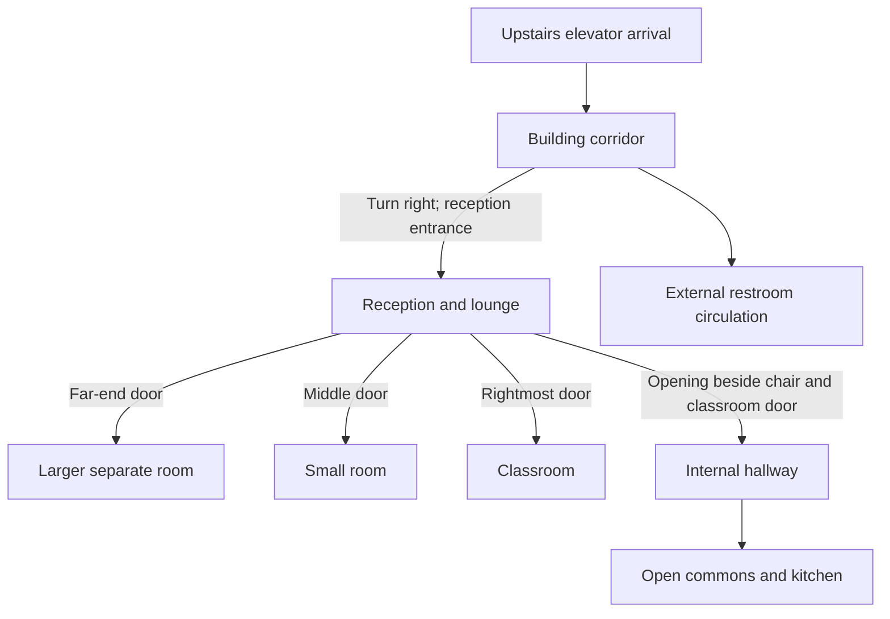

# Pursuit building review and Godot playtest

**Current layout:** Blender, Godot and the browser viewer use one photo-based
building export. Godot adds the player, camera, entrance puzzle and elevator
behavior. It no longer generates a separate room plan after importing the GLB.
The earlier runtime-only arrangement is superseded; Git retains its history.

## Launch and controls

From the repository root, double-click **Play Building.cmd**, or run:

```powershell
python tools/run_playtest.py
```

Use an existing Godot 4.7+ installation and Python 3.10+. The Windows launcher
can reuse Blender's bundled Python. Set `GODOT_BIN` to an existing executable if
tool discovery cannot find Godot. No browser server is required to play.

For inspection without the entrance game, double-click **Review Building.cmd**
or run `python tools/run_playtest.py --review`. The debug-only **Building Review**
banner confirms the entrance bypass. Press F3 and use **Bypass entrance puzzle
for building review** to toggle it, or use the location buttons to travel.
Disabling review restores the entrance lock unless you actually solved it.
The bypass grants no puzzle completion and does not disable world boundaries.

Orange-and-white barricades mark both street limits, just beyond the trees
flanking Pursuit. Invisible collision closes those limits across both sidewalks
and the road; it stays active during building review. Roads, side streets and
industrial building scenery continue beyond the barricades on both ends.
Those background blocks suggest the neighborhood rather than claiming surveyed
photo matches. The shared manifest records the review bounds separately from
the photographed building footprint.

- Move with WASD/arrows; hold Shift to run.
- Move the mouse to look; use the wheel to zoom.
- Press E near the street entrance to solve Sense → Decide → Act and enter the
  revealed code. The lock persists for this session; R does not relock it.
- Walk through the entrance, use the stairs or right ramp, approach the lower
  elevator and press E. Upstairs, turn right; reception's glazed entrance is
  straight ahead. The outside restroom corridor branches near reception.
- Reception has separate doors for the larger room, small room and classroom.
  The chair-side internal passage leads to commons. It is distinct from the
  outer restroom corridor.
- Esc opens Settings; R resets the current review location. F3 exposes developer
  review teleports. Those are inspection tools, not gameplay progression.

The elevator shooter, check-in UI, stand-up sequence, Mr. P and robot challenge
are still separate gameplay work. The environment redesign does not implement
those features or change the approved retry/energy rules.

## October 27 photo-based layout correction plan

The [reference folder](https://drive.google.com/drive/folders/1eSOzOeCtZ_QwVe4NcJFAeeQdDKk-Z5Vv)
contains 34 still photographs and 33 MOV companions. All 34 stills were visually
reviewed; the MOV companions were inventoried, not reviewed. The photo-based
assembly now replaces the preceding model layout in both viewers.

There are **two playable floors**: ground/first floor at street level and the
lower elevator forecourt, and second floor for Pursuit's reception, classroom
and commons. Higher exterior storeys and neighboring buildings are scenery.
Dimensions, unobserved room interiors and exact hallway lengths are estimates,
not surveyed measurements. The internal approach/turn toward commons remains
inferred from overlapping photographs.

### Confirmed reception connections

In [IMG_4794](https://drive.google.com/file/d/1sgrYFhgjDaR9eUA3SsFhp2H56h2UKWDd/view),
read the visible doors from left to right:

| Photo landmark | Confirmed destination |
| --- | --- |
| Glass entrance doors on the left | Reception entrance seen after turning right on leaving the upstairs elevator. |
| Door at the far end | Larger separate room. |
| Middle room door | Small room between that larger room and the classroom. |
| Rightmost room door | Existing classroom. |
| Opening beside the chair and classroom doorway | Internal hallway access. |

This is a connection schematic, not a measured floor plan. Node position does
not establish compass orientation, room size or wall alignment. Lines are
routes, not permission to add doors between the three separate rooms.



The internal-hallway-to-commons bearing is inferred from the overlapping reception,
passage and commons photographs, especially IMG_4795, IMG_4796 and IMG_4799.
The passage has a straight sightline between its confirmed reception-side and
commons thresholds; the earlier right-angle dogleg was removed during review.
Keep it distinct from the external building/restroom corridor. The photos do
not establish another direct route from that external corridor into the commons.
Do not merge those passages or infer new connections through unseen rooms.

### Photo coverage

| Photos | Placement | Implemented treatment |
| --- | --- | --- |
| 4770-4774 | Opposite-side streetscape | Matching industrial masses, window rhythms and roof pavilion. |
| 4775-4781 | Pursuit-side frontage and adjacent buildings | Reworked façade divisions, height and rooflines; higher storeys are scenery. |
| 4782 | Main street entrance | Narrower glazed framing with the entrance puzzle attached to its threshold. |
| 4783-4787 | Ground entrance, stairs, yellow partition, ramp and bakery window | Retained recognizable components with revised context, bakery glazing, services and supports. These views do not fully establish the ground elevator-bank frontage. |
| 4788-4789 | Upstairs elevator landing and corridor | Narrower landing with end-window and blue-glazing landmarks. |
| 4790-4793 | Outside reception and restroom circulation | Reworked reception threshold, separate outer corridor and columns. |
| 4794-4797 | Reception/lounge and internal passage | Dennis's confirmed destinations, revised wall handedness, lounge and white far wall. |
| 4798-4801 and 4803 | Open commons | Connected commons with end kitchen, island, windows, seating, tables, booths and blue-wall landmarks. |
| 4802 | Side workspace and telephone closet beside the commons | Side recess represented with estimated bounds; unseen interior details remain unverified. |


## Shared assets and maintenance

The canonical portable GLB is `trials/building-review/assets/pursuit-building.glb`.
Its identity, per-mesh cutaway metadata and review cameras are in `scene.json`.
`tools/prepare_playtest.py` checks that hash and stages the same geometry into
Godot's ignored generated-assets folder. Do not edit the staged copy directly.

[Building-Assembly.md](Building-Assembly.md) explains native Blender masters,
metre units, floor/module origins, collection assets, shared mesh data, doorway
interfaces and named gameplay anchors. The original Blender master is retained;
the redesign has its own native master. Native masters and new reference photos
are outside the public repository.

All 646 retained classroom props preserve their shape and material parameters.
Their placement uses one rigid classroom move, with two declared rigid exceptions:
the notice board and three attached notices mount to a solid wall, and a six-piece
planter sits inside the classroom instead of outside the façade. The native
validator independently reimports the pinned source and compares every vertex
under these declared transforms, as well as checking room bounds.

## Verification

After rebuilding/promoting the export, import the Godot project, then run:

```powershell
python -m unittest discover -s tests
python tools/run_playtest.py --test
```

Additional Godot scripts under `godot/playtest/tests/` verify layout/doorway
clearances (`verify_layout.gd`), controls (`verify_controls.gd`) and the entrance
puzzle (`verify_entrance.gd`). Run with `godot --headless --path godot --script
res://playtest/tests/<script>.gd`. Use `capture_environment.gd` to render the
export's reference viewpoints and `capture_playtest.gd` for actual game views.
Native Blender validation is separate from the runtime checks.

Technical checks establish geometry interfaces, source preservation and tested
routes. They do not establish measured accuracy, user approval, or that every
unseen detail matches the building. Furniture and façade details are stylized.

## Envelope and review consistency

The main facade encloses the entire occupied floor footprint. Adjacent scenery
begins outside that footprint; it does not supply transparent exterior walls for
the classroom or commons. Solid piers, spandrels and window heads close the
facade bays. Closed service pockets, classroom returns and the commons rear
corner are checked with rays against the imported geometry. `verify_layout.gd`
also checks the straight passage sightline and samples formerly open facade
bands. `tools/verify_environment_fresh.py` runs the engine suites in an
isolated, initially empty import cache with retained current inputs.

Game and review renders share `playtest/EnvironmentLighting.gd`, including
ambient/contact shading. The character review retains its separate studio.

## Optional browser review

Use `trials/building-review/Open Review.cmd` or run:

```powershell
python trials/building-review/serve.py --open
```

Open the local address shown by the server. Orbit, zoom, choose a floor or photo
view, and download the same GLB used by Godot. This is a static model review;
it does not simulate elevator travel, the avatar or game interactions.
The server's allowlist excludes private source files and reference photographs.
