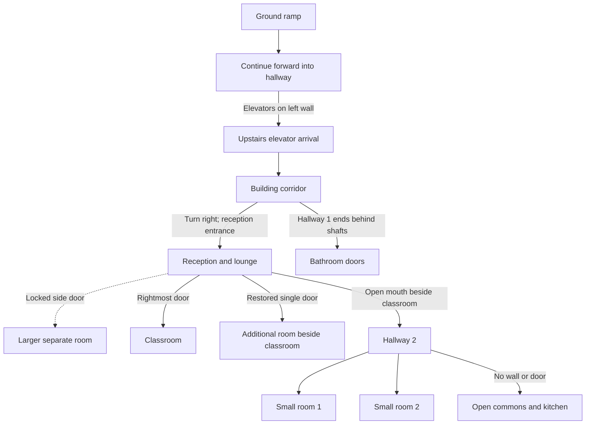

# Pursuit building review and Godot playtest

**Current layout:** Blender, Godot and the browser viewer use one blueprint-based
building export. Godot adds the player, camera, entrance puzzle and elevator
behavior. It no longer generates a separate room plan after importing the GLB.
The October 25 blueprint, reapproved on October 28, controls the room connections.
The photographs supply visual detail. The rejected photo-inferred floor topology
is superseded; Git retains its history.

## Launch and controls

From the repository root, double-click **Play Game.cmd**, or run:

```powershell
python tools/run_game.py
```

Use an existing Godot 4.7+ installation and Python 3.10+. The Windows launcher
can reuse Blender's bundled Python. Set `GODOT_BIN` to an existing executable if
tool discovery cannot find Godot. No browser server is required to play.

For inspection without the entrance or elevator games on Mac or Windows, open
**Settings** (Esc), choose **Developer Tools**, and enable the puzzle-gate bypass.
Resume the game to explore freely. The review banner confirms bypass mode.
Turn the same toggle off to restore undefeated gates. The bypass is session-only, grants
no puzzle completion and does not disable world boundaries or locked side rooms.

The one Windows launcher accepts `--dev`, as does
`python tools/run_game.py --dev`, to start review directly. F3 opens the same
developer controls. Settings provides access without a terminal or function-key
shortcut. Developer controls are available in this debug project and disabled
in release builds; release packaging is a separate, unverified step.
Esc always opens regular Settings. Developer Tools contains the position/FPS
readout, the bypass toggle and location buttons. The 1/2/3 location shortcuts
work only while developer bypass is enabled. Winning the games does not enable
those shortcuts during normal play.

Orange-and-white barricades mark both street limits, just beyond the trees
flanking Pursuit. Invisible collision closes those limits across both sidewalks
and the road; it stays active during building review. Roads, side streets and
industrial building scenery continue beyond the barricades on both ends.
Those background blocks suggest the neighborhood rather than claiming surveyed
photo matches. The shared manifest records the review bounds separately from
the photographed building footprint.

- Move with WASD/arrows; hold Shift to run.
- Move the mouse to look; use the wheel to zoom.
- Press E near the street entrance to open the four-level pipe puzzle. Click or
  Enter rotates pipes; Tab/arrows selects a tile. Connect IN to OUT and choose
  Test circuit. Each win shows a different word order; the fourth reveals
  **Welcome to Pursuit** and the entry code. Enter that code to unlock the door.
  Hint marks a pipe and explains its ports; Reset level resets only the current
  unfinished board. Esc closes and retains progress. There is no time limit or
  energy cost. The lock persists for this session; R does not relock it.
- Walk through the entrance and up the stairs or right ramp. Continue forward
  into the hallway; the elevators are on its left wall. Press E near the first
  cab to open the spaceship shooter. Choose Launch flight; WASD/arrows move,
  hold Space to shoot, P pauses and Esc closes while saving the current run.
  Clear three waves (18 drones) and choose Ride upstairs. Three shields and
  unlimited retries are temporary arcade settings; they do not affect course
  energy or score. Winning unlocks later rides until restart. Descending is free.
  Upstairs, the exit faces a closed white door. Turn right toward reception.
- Reception has direct classroom double doors beside the desk, a locked glazed single
  door to the L-shaped larger room, an open single glazed door to the additional
  room beside the classroom, and an open connection to Hallway 2. That hallway
  passes two small rooms and joins the commons without a door or wall. Hallway 1
  separately ends at the bathrooms behind the elevator shafts.
- The yellow ground side-room door also stays locked during building review.
  The bench is against the wall opposite the lifts. The kitchen is along the
  bathroom-side wall, beside Godot position `(-7.23, 5.07, -9.49)`, and reception's
  footprint is approximately 9.4 by 5.74 m after the latest expansion. Hallway 2
  has about 3.18 m clear width; the classroom retains approximately 82.4% of its
  preceding floor area and all six table groups.
- Esc opens Settings; R resets the current review location. F3 exposes developer
  review teleports. Those are inspection tools, not gameplay progression.
- The reception computer offers **E / Check in** during normal play. Finish both
  gate games and arrive upstairs, then enter a display name, take the simulated
  avatar photo and explicitly confirm. Continue to classroom shows the short
  Program Manager stand-up, synthetic crowd response and get-to-work sequence.
  Esc/Settings pauses the classroom sequence; developer travel cancels it.
- Other computers and laptops have **E / Use computer** above the display when
  nearby on the same floor. Approach and face a computer, then press E to fade
  into Mr. P's hexagonal purple room. Move around normally; use E at its marked
  return pad to return to that same computer. R resets your position inside the
  room. The wall panels are layout previews; questions and rewards are not active.

The check-in and stand-up sequence are connected locally. The Program Manager
uses an existing character and scripted captions; final likeness/name/voice are
not supplied. Live Mr. P questions and the robot challenge remain separate work. The computer portal is a
spatial playtest and grants no story progress or changes to retry/energy rules.

A Builder near the street entrance has **E / Ask Builder** for current-objective,
pipe/shooter hints and step-by-step help. The default local help needs no key;
`--agents` permits bounded Claude wording after a help choice. Two reception
NPCs retain **E / Talk** with scripted topics. A later reception entry can play
four authored public lines once both have met the player. Esc closes dialogue.
See [NPC agents](NPC-Agents.md) for memory, cancellation and provider scope.

Run the encounter checks from the repository root:

```sh
godot --headless --path godot --script res://developer/tests/verify_shooter.gd
godot --headless --path godot --script res://developer/tests/verify_elevator.gd
godot --path godot --script res://developer/tests/play_shooter.gd
```

The last command runs one rendered, keyboard-input-driven
flight from the lower cab through a verified win and upper-floor arrival,
saving screenshots and a receipt under `.godot/playtest/shooter-playthrough`.
Append `-- --output=<directory>` to choose its output directory.
The pilot spawns at the cab and fixes the hazard RNG, then uses only normal
keyboard events. It does not grant a win, remove enemies or change shields.

## Approved blueprint and photo references

The authoritative drawing is `Proposed Hallway Rooms - Aligned with Hallway 1.png`
in the private Creative reference folder. Dennis approved its connections on
October 25 and reapproved them on October 28. The manifest records its SHA-256.
Its filename predates that approval. It is not to scale: room dimensions can
change to fit the references while the approved connections remain fixed.

The [reference folder](https://drive.google.com/drive/folders/1eSOzOeCtZ_QwVe4NcJFAeeQdDKk-Z5Vv)
contains 34 still photographs and 33 MOV companions. All 34 stills were visually
reviewed; the MOV companions were inventoried, not reviewed. These photographs
guide materials, glazing, furnishings, services and exterior appearance. They
do not override the approved blueprint's ramp hallway or upstairs room plan.

There are **two playable floors**: ground/first floor at street level and the
lower elevator forecourt, and second floor for Pursuit's reception, classroom
and commons. Higher exterior storeys and neighboring buildings are scenery.
Dimensions, unobserved room interiors and exact hallway lengths are estimates,
not surveyed measurements. The drawing left the additional front room's access
unspecified. Dennis's later October 28 clarification confirms its direct door
from reception; that connection is now part of the required door inventory.

### Reception photo landmarks

In [IMG_4794](https://drive.google.com/file/d/1sgrYFhgjDaR9eUA3SsFhp2H56h2UKWDd/view),
read the visible doors from left to right:

| Photo landmark | Confirmed destination |
| --- | --- |
| Glass entrance doors on the left | Reception entrance seen after turning right on leaving the upstairs elevator. |
| Door at the far end | Larger separate room. |
| Middle room door | Additional room beside the classroom; direct reception access confirmed by Dennis on October 28. |
| Rightmost room door | Existing classroom. |
| Opening beside the chair and classroom doorway | Internal hallway access. |

The following schematic records the approved playable connections. It is not a
measured plan; node position does not establish compass orientation or dimensions.



Hallway 2 runs beside the classroom into the large open indoor area. Its two
small rooms stop at Hallway 1's end line, as drawn. Keep Hallway 1 and Hallway 2
distinct, and do not add a shortcut through the bathrooms or an unseen room.

### Photo coverage

| Photos | Placement | Implemented treatment |
| --- | --- | --- |
| 4770-4774 | Opposite-side streetscape | Matching industrial masses, window rhythms and roof pavilion. |
| 4775-4781 | Pursuit-side frontage and adjacent buildings | Reworked façade divisions, height and rooflines; higher storeys are scenery. |
| 4782 | Main street entrance | Narrower glazed framing with the entrance puzzle attached to its threshold. |
| 4783-4787 | Ground entrance, stairs, yellow partition, ramp and bakery window | Retained original core and fixed bank coordinates, forward hallway, bakery glazing, services and supports. |
| 4788-4789 | Upstairs elevator landing and corridor | Narrower landing with end-window and blue-glazing landmarks. |
| 4790-4793 | Outside reception and restroom circulation | Reworked reception threshold, separate outer corridor and columns. |
| 4794-4797 | Reception/lounge and internal passage | Photo finishes and lounge landmarks fitted to the approved direct classroom and Hallway 2 connections. |
| 4798-4801 and 4803 | Open commons | Kitchen finishes and island relocated to the bathroom-side wall confirmed in the walkthrough; lounge seating occupies the former kitchen side. |
| 4802 | Side workspace and telephone closet beside the commons | Side workstation dressing has estimated placement. The telephone closet's interior and separate access are not modeled. |


## Shared assets and maintenance

The canonical portable GLB is `trials/building-review/assets/pursuit-building.glb`.
Its identity, per-mesh cutaway metadata and review cameras are in `scene.json`.
`tools/prepare_game.py` checks that hash and stages the same geometry into
Godot's ignored generated-assets folder. Do not edit the staged copy directly.

[Building-Assembly.md](Building-Assembly.md) explains native Blender masters,
metre units, floor/module origins, collection assets, shared mesh data, doorway
interfaces and named gameplay anchors. The original Blender master is retained;
the redesign has its own native master. Native masters and new reference photos
are outside the public repository.

All 646 retained classroom props preserve their shape and material parameters.
Declared rigid assembly translations fit the tables, chairs, lighting and storage
to the shorter classroom; the complete planter remains inside the room.
The native validator independently reimports the pinned source and compares every vertex
under these declared transforms, as well as checking room bounds. It also
compares all retained ground-core and lift-bank shapes and materials against
the original source, including the declared rigid closed pose for the yellow leaf.

## Verification

After rebuilding/promoting the export, import the Godot project, then run:

```powershell
python -m unittest discover -s tests
python tools/run_game.py --test
```

Additional Godot scripts under `godot/developer/tests/` verify layout/doorway
clearances (`verify_layout.gd`), controls (`verify_controls.gd`) and the entrance
puzzle (`verify_entrance.gd`). Run with `godot --headless --path godot --script
res://developer/tests/<script>.gd`. Use `capture_environment.gd` to render the
export's reference viewpoints and `capture_playtest.gd` for actual game views.
Native Blender validation is separate from the runtime checks.

`verify_pipes.gd` checks the four boards and connectivity rules. For a rendered
entrance playthrough, run the same script command with `play_entrance_pipes.gd`
and omit `--headless`. It rotates tiles through native mouse/keyboard input,
tests each circuit, types the displayed code and walks through the unlocked
door. Screenshots and `playthrough.json` are saved to
`.godot/playtest/entrance-pipes`; append `-- --output=<directory>` to choose a
different destination. Its test pilot searches the visible pipe shapes rather
than reading the authored solution or granting completion.

Technical checks establish geometry interfaces, source preservation and tested
routes. They do not establish measured accuracy, user approval, or that every
unseen detail matches the building. Furniture and façade details are stylized.

## Envelope and review consistency

The main facade encloses the entire occupied floor footprint. Adjacent scenery
begins outside that footprint; it does not supply transparent exterior walls for
the classroom or commons. Solid piers, spandrels and window heads close the
facade bays. `verify_layout.gd` checks doorway clearances, the closed opposite
door, the forward ramp hallway, bank-end floor support, the right-turn reception
sightline and the open Hallway 2/commons join against the imported geometry.
It also samples the main facade's joints and formerly open bands.
The approved door inventory in [Building-Assembly.md](Building-Assembly.md#approved-door-inventory)
is checked for physical frames and leaves as well as openings. The additional
room doorway, expanded reception and added hallway width have actual walking
checks; a manifest-only connection cannot establish a playable route.
`tools/verify_environment_fresh.py` runs the engine suites in an
isolated, initially empty import cache with retained current inputs.

Game and review renders share `game/EnvironmentLighting.gd`, including
ambient/contact shading. The character review retains its separate studio.

## Optional browser review

Use `Play Game.cmd --browser-review` or run:

```powershell
python trials/building-review/serve.py --open
```

Open the local address shown by the server. Orbit, zoom, choose a floor or photo
view, and download the same GLB used by Godot. This is a static model review;
it does not simulate elevator travel, the avatar or game interactions.
The server's allowlist excludes private source files and reference photographs.
